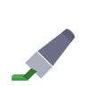

  
  <h1>Ash Highlight</h1>
  
<strong>Highlight, annotate, and manage text on any web page.</strong>

Highlight text on any web page with colors, notes, and tooltips. Manage your highlights from the toolbar popup. Your highlights stay on your device.

## Install (Chrome, Edge, or other Chromium browsers)

1. Download the latest zip file from the Releases page and unzip it. Keep the folder somewhere permanent, because the browser reads it from there.
2. Open `chrome://extensions` (Edge: `edge://extensions`).
3. Turn on **Developer mode**.
4. Click **Load unpacked** and choose the unzipped `highlight` folder.

To update, download the new zip, replace the folder's contents, and click the reload icon on the extension card.

Chromium browsers block extensions installed from outside their store unless loaded this way, so this method is the supported option.

## Permissions

Ash Highlight asks for two things, and nothing else:

- **Storage** (`storage`): saves your highlights, notes, palette, and settings on your device. Nothing is uploaded.
- **Access to all websites** (`<all_urls>`): lets the highlighter run on any page you open, so you can highlight there. It reads the text on the page you're viewing and doesn't send it anywhere.

It doesn't read your browsing history, use your tabs list, or make network requests of its own.

**Your data remains on your computer.** Highlights are kept in your browser's local extension storage (`chrome.storage.local`), which lives on this computer only. It isn't synced to other devices, and websites and other extensions can't read it. Removing the extension deletes it. The only time data leaves the browser is when you choose Export, and then the file is saved wherever you pick.

## Bug reports and feedback

Found a bug, or have a complaint or suggestion? Open an issue in the **Issues** tab of this repository. The more detail you give, the faster it can be fixed:

- What you did, and what you expected to happen.
- What happened instead, including any error message.
- Your browser and its version, and the extension version (shown on `chrome://extensions`).
- The website where it happened, if it's not private.

Please don't post private information, such as passwords or personal highlights, in an issue. Screenshots are welcome, but crop out anything sensitive.

## Use

- Select text to see the highlight popup. Choose a color to highlight.
- Click a highlight to open its popup, add a note with `+`, or resize it with the blue handles.
- Ctrl+Shift+J highlights the selection with Color 1. Default: #BBD9B8
- Ctrl+Shift+K highlights the selection with Color 2. Default: #A9DAF0
- Ctrl+Shift+X erases the highlight you're on, or the highlight in your selection.
- Ctrl+Shift+Z undoes the last change on the page, and Ctrl+Shift+Y redoes it.

NOTE: If you have other extensions installed then their keybindings may conflict with this extension.
In that case you may need to edit `content.js` manually to use another keybinding. No Code custom 
keybinding directly from action popup maybe added in future updates. 

- The shortcuts can be changed in `content.js`, under "Tunable: keyboard shortcuts".
- Click the toolbar icon to see, search, and manage all highlights.
- The undo button in the toolbar popup reverses the last change on the current page.

## Backup

Chrome deletes an extension's data when it is removed. Use **Export** in the toolbar popup regularly, and keep the file somewhere safe.

## Privacy

Highlights, notes, and settings are stored only in this browser. Nothing is sent to any server.

## About this project

It is mostly a personal-use project, but open sourced so others may also benefit. Development was AI-assisted to finish the project quickly. It isn't supposed to be professional or commercial. Nor is it supposed to show my skills.

If you find any issues or bugs, feel free to open an issue in the Issues tab.

## License

Ash Highlight is released under the MIT License. See [LICENSE](LICENSE) for the full text.

Third-party assets:

- **Icons:** [Heroicons](https://heroicons.com), MIT License.
- **Colors:** the [Catppuccin](https://catppuccin.com) palette, MIT License.
